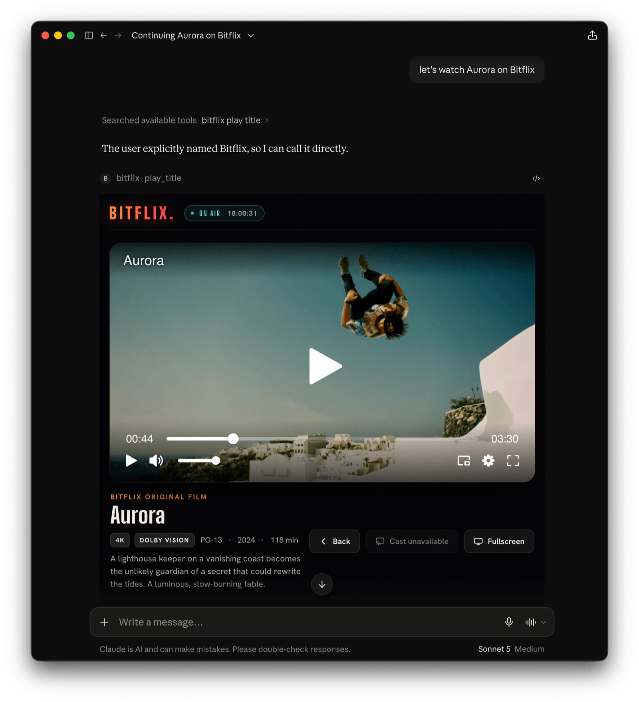

# Bitflix - MCP Apps Example Application

Bitflix is a fictional streaming network (sports · news · films · originals) shipped as an
[MCP App](https://modelcontextprotocol.io).

You open it, browse it, get recommendations, and watch, all by talking to ChatGPT or Claude. It's a reference
implementation, and a working answer to:

> _What does an online video platform need to be when the "app" is a conversation and the UI is generated on the fly?_

Bitflix is built on the [Skybridge](https://github.com/alpic-ai/skybridge) React framework for MCP Apps,
so you can run it in the local playground, expose it through a dev tunnel, or deploy it to a permanent URL.
The [Bitmovin Player](https://bitmovin.com/video-player/) handles video playback directly in the chat widget.



It also includes **Bitflix Discover**, a content-discovery mode built on the
[OpenAI plugin extensions](https://developers.openai.com/plugins/build/extensions): browse and search a catalogue of
real open movies, watch a 60-second preview in the chat, then follow a link to where the full film plays. In ChatGPT,
Discover opens from the left navigation bar and its Trailer Reel from a conversation's side panel. It needs no DRM.
See [Bitflix Discover](#bitflix-discover).

## What's in the box

```
src/
├── catalog.ts          # content: titles, sections, search/recommend
├── streams.ts          # public test streams as the player loads them, keyed by id
├── index.ts            # entry point: runs the app
├── server.ts           # Skybridge app + 8 tools (5 Bitflix, 3 Discover), CSP, plugin-extension metadata
├── discover/           # Bitflix Discover, server side
│   ├── model.ts        #   shared types and pure helpers, the only Discover module views import
│   ├── catalog.ts      #   the open movies, preview windows, stream and watch origins
│   ├── search.ts       #   free-text matching that misses rather than guesses
│   └── screens.ts      #   builds each Discover tool's structuredContent
├── env.ts              # typed env (BITMOVIN_PLAYER_KEY)
├── helpers.ts          # generateHelpers<AppType>() → typed useToolInfo / useCallTool
└── views/
    ├── browse.tsx · recommend.tsx · live.tsx · player.tsx · diagnostics.tsx  # one entry per tool
    ├── discover.tsx · film.tsx · reel.tsx                                    # Discover's entries
    ├── css/index.css       # stylesheet (theme, rails, tiles, chips, player stage)
    ├── css/discover.css    # Discover's styles: search, film detail, preview end card, trailer reel
    ├── hooks.ts            # view hooks
    └── components/
        ├── BitflixApp.tsx          # shared widget: browse + player + cast + chips
        ├── BitmovinPlayer.tsx      # Bitmovin Player in a React component
        ├── BitmovinPlayerLazy.tsx  # code-split wrapper around the player
        ├── Diagnostics.tsx         # video-capability probe for the host sandbox (DRM, fullscreen, cast…)
        ├── Icon.tsx                # inline SVG icon component
        ├── cover.ts                # inline SVG cover art, one of nine hand-drawn scenes
        └── discover/               # DiscoverApp, TrailerReel, PreviewPlayer (+ lazy wrapper), shared bits
test/
├── unit/               # Discover: catalogue, search, screens, model helpers
└── mcp.test.ts         # boots the built server and checks what it puts on the wire
```

### Tools

Each tool the server offers binds to a view via `registerTool({ view: { component } })`.

| Tool                  | View          | Example utterance                    |
| --------------------- | ------------- | ------------------------------------ |
| `browse_catalog`      | `browse`      | "open Bitflix", "show me sports"     |
| `get_recommendations` | `recommend`   | "what should I watch tonight?"       |
| `whats_live`          | `live`        | "any games on?", "what's live?"      |
| `play_title`          | `player`      | "play the finals", "resume Aurora"   |
| `run_diagnostics`     | `diagnostics` | "test what video features work here" |
| `discover`            | `discover`    | "find me something to watch"         |
| `trailer_reel`        | `reel`        | "show me some trailers"              |
| `preview_film`        | `film`        | "show me Sintel", "the bunny one"    |

The first four tools render the shared `BitflixApp`, which switches between the browse face and the player
face via `payload.view`. Clicking a tile starts playback, the category chips call back to the server with
`useCallTool`, and `data-llm` keeps the model in sync with what's on screen.

The `run_diagnostics` tool renders the `Diagnostics` view, a live probe of what the current MCP host's widget
sandbox supports for video. It covers MSE, EME/DRM key systems (Widevine, PlayReady, FairPlay, ClearKey), Web
Workers, WebAssembly, fullscreen (host display-mode request and native Fullscreen API), Picture-in-Picture,
casting/Presentation, and autoplay.

### Content / Streams

All streams are **public test assets**, so the demo works out of the box:

- **VoD** plays HLS and DASH "Art of Motion" test content hosted on `cdn.bitmovin.com`
- **Live** plays [DASH-IF livesim2](https://livesim2.dashif.org), a real live DASH stream that is fully public
  (CORS `*`, self-hosted segments)
- Cover art is inline SVG, composed from one of nine hand-drawn scenes (court, pitch, globe, film, summit, orbit…)

**Content Security Policy:**

The app's widget runs in a sandboxed iframe and can only reach origins the server declares up front. So `VIEW_CSP`
in `src/server.ts` allow-lists the origins hosting the content and any other network-loaded resources.
See [CSP & CORS](https://apps.extensions.modelcontextprotocol.io/api/documents/csp-and-cors.html) in the MCP Apps docs.

## Bitflix Discover

Discover answers a different question from the rest of Bitflix: _what does content discovery look like when the
assistant is the front door and your service is where people watch?_ For a media company that needs a catalogue,
good search and a preview that sells the title, not full-length playback or content protection. So Discover has no
DRM: previews are clear HLS and DASH, and the full film opens on the provider's own site.

| Tool           | How it opens                                                      |
| -------------- | ----------------------------------------------------------------- |
| `discover`     | **Global entry point:** left nav bar in ChatGPT, opens fullscreen |
| `trailer_reel` | **Thread entry point:** a tab in the side panel next to a chat    |
| `preview_film` | Called by the model for one title                                 |

All three can also be called by the model, and hosts without the extensions (Claude, for example) render them
inline. Search and the genre chips call `discover`; opening a film calls `preview_film` for its related films, so
every screen comes from the server and the model sees what the user asked for.

**Plugin extensions.** They are plain `_meta` keys
([spec](https://github.com/openai/mcp-extensions/blob/main/docs/spec.md)), set in `src/server.ts`. Entry points go
on the tool, and ChatGPT calls an entry-point tool with `{}`, so its inputs are optional. ChatGPT allows one global
and one thread entry point per app, which is why the Bitflix tools declare none:

```ts
_meta: { 'openai/ui': { entrypoints: [{ type: 'global' }] } }, // or [{ type: 'thread' }]
```

Display modes go on the view resource, so the host knows before rendering whether the app can go fullscreen:

```ts
view: { component: 'discover', csp: DISCOVER_CSP, _meta: { 'openai/ui': { availableDisplayModes: ['inline', 'fullscreen'] } } },
```

Skybridge spreads `view._meta` over the metadata it generates, so never put a `ui` or `openai/widgetCSP` key there.
`test/mcp.test.ts` checks for both.

**Previews without a trailer encode.** A preview is a window into the full film's stream: `PreviewPlayer` loads it
with a `startOffset`, counts down the window and pauses at its end, then shows the hand-off and a replay button.
Seeking back before the window returns to its start. The player only picks renditions no larger than itself.

**Content.** Eleven [Blender Studio open movies](https://studio.blender.org/projects/); three (Sintel, Tears of
Steel, Big Buck Bunny) have previews, and every "Watch" link goes to the film's page on Blender Studio. Previews
stream from Google's [Shaka Player demo assets](https://storage.googleapis.com/shaka-demo-assets/) and
[Mux's test streams](https://test-streams.mux.dev/), which answer any origin, so they also work in the local
playground. Bitmovin does not control those hosts; for your own app, serve previews from an origin you control.
`DISCOVER_CSP` allow-lists exactly those stream origins plus `licensing.bitmovin.com`, and declares Blender Studio as
a redirect domain so ChatGPT opens the watch links without its safe-link interstitial.

**License key.** Discover sends the player key in each tool result's `_meta`, which only the widget reads, not in
`structuredContent`, which hosts also hand to the model. That keeps it out of the conversation, not secret: anyone
who can reach the MCP URL can call a tool and read it. Use a dedicated key, never a production one.

## Bitmovin Player license key

The `bitmovin-player` dependency is a proprietary, commercially-licensed SDK. See the [Licensing](#licensing) section.
Visit the [Bitmovin dashboard](https://dashboard.bitmovin.com/player/licenses) to start a trial subscription or retrieve
a license key for your active subscription.

## Run it

Requires Node 22.23.1+ (24+ is recommended).

```bash
npm ci
cp .env.example .env        # create .env file and add your own BITMOVIN_PLAYER_KEY
npm run dev                 # then open the DevTools playground at http://localhost:3000
```

- `npm run dev`: local DevTools playground at port `3000` (run each tool, audit CSP, etc.)
- `npm run dev:tunnel`: same, exposed over a stable tunnel you can add to Claude/ChatGPT
- `npm run build` / `npm start`: production build / serve
- `npm run deploy`: deploy to [Alpic](https://alpic.ai/) for a permanent HTTPS URL
- `npm test`: Discover's unit tests, then an MCP integration test that builds and boots the server (`test:unit` and
  `test:mcp` run them separately)

**Player domain allow-listing:**

A Bitmovin Player license only works on the domains you register for it in the
[Bitmovin dashboard](https://dashboard.bitmovin.com/player/licenses).

- Allow-list the MCP hosts' sandbox domains: `claudemcpcontent.com` for Claude and `oaiusercontent.com` for ChatGPT.
  The dashboard does not accept wildcards, and a listed domain covers all its subdomains, which is where the widgets
  run.

- When testing on the DevTools playground in a web browser on a non-localhost domain (tunnel or a deployed URL), also
  allow-list that domain.

### Connect to your MCP host (e.g. Claude or ChatGPT)

1. Run `npm run dev:tunnel` to get a public URL to your MCP server, e.g. `https://foo-bar-42.alpic.dev/mcp`
2. Add this URL as a custom MCP/connector in your Claude/ChatGPT app (in ChatGPT, turn on Developer mode first,
   under Settings → Security and login)
3. Open a new chat and write _"open Bitflix"_, _"what's live?"_, _"recommend something short"_, _"find me
   something to watch"_
4. Where your ChatGPT plan has the plugin extensions, open **Discover** from the left navigation bar, or **Trailer
   Reel** from a conversation's side panel

### Troubleshooting

If the MCP app does not render:

- Use the Claude or ChatGPT app. Not every MCP host renders MCP Apps views; some may show only the tool call and
  its text result.
- Update the Claude/ChatGPT app. MCP Apps support is new, and older versions may not render views.
- Open the MCP URL (e.g. `https://foo-bar-42.alpic.dev/mcp`) in a web browser. A running server answers with a
  small JSON error (`Method not allowed`).
- If run with `npm run dev`, open the MCP URL without the `/mcp` path to reach the DevTools playground and run the
  tool there. If the view renders, the server is fine and the problem is on the host app side.
- Remove and re-add the MCP connector in your host app.

## Known Issues & Limitations

The MCP host (e.g. Claude, ChatGPT) controls the widget sandbox's capabilities. The
[MCP Apps specification](https://apps.extensions.modelcontextprotocol.io) is still under active development, so those
capabilities currently vary between hosts and shift as the specification and the host implementations evolve.
Depending on which host is used, the following features may behave differently or not work at all:

- Fullscreen
- Autoplay with sound
- Playback of DRM-protected content
- Remote Playback (Google Cast and Apple AirPlay)
- Picture-in-Picture
- Client-side advertising

Run the `run_diagnostics` tool in your host to see what it permits.

For Bitflix Discover specifically:

- **Entry points are ChatGPT-only, and not on every plan yet.** Other hosts ignore the `openai/ui` metadata and render
  the views inline.
- **No custom entry-point icon.** Skybridge 2.0.x's tool type has no `icons` field, so ChatGPT falls back to the
  server's icon.
- **The player's timeline shows the whole film.** Seeking past the preview window ends the preview.

## Licensing

The source code in this repository is released under the [MIT License](./LICENSE).

The Bitmovin Player SDK (`bitmovin-player` NPM dependency) is proprietary and commercially licensed by Bitmovin.
To run this app you must get your **own** Bitmovin Player license key from the
[Bitmovin dashboard](https://dashboard.bitmovin.com/player/licenses) and comply with the
[Bitmovin Player license terms](https://bitmovin.com/player-license/).

The streams in the catalog are third-party public test assets, used for demonstration only.

Bitflix Discover's films are © Blender Foundation | studio.blender.org, published under Creative Commons Attribution
licenses (CC BY 4.0 unless noted otherwise, see Blender Studio's
[terms](https://studio.blender.org/terms-and-conditions/)).

---

_Bitflix, its teams, scores, and titles are fictional. The films in Bitflix Discover are real open movies._
